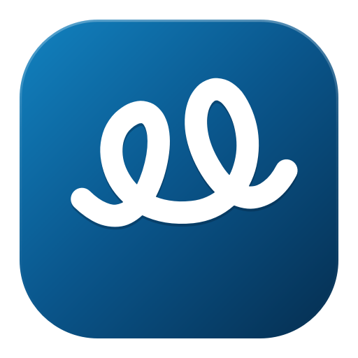

<div align="center">
  
  <h1>Vait - Infinite Canvas Whiteboard</h1>
  <p><strong>A modern, high-performance Windows desktop application built with Python and PySide6 (Qt for Python).</strong></p>

  <p>
    <a href="https://www.python.org/"></a>
    <a href="https://wiki.qt.io/Qt_for_Python"></a>
    <a href="https://www.microsoft.com/windows"></a>
    <a href="https://docs.pytest.org/"></a>
    <a href="LICENSE"></a>
    
  </p>
</div>

---

Centered around an **infinite, pannable, zoomable canvas**, Vait provides a fluid, hardware-accelerated creative space where you can freely organize high-resolution images, editable multiline text, geometric shapes, and smooth freehand pen drawings.

---

## Quick Start

### Installation & Setup

1. **Clone the repository**:
   ```powershell
   git clone https://github.com/Agnivesh-Anil-Warrier/Vait.git
   cd Vait
   ```

2. **Create and activate a virtual environment**:
   ```powershell
   python -m venv .venv
   .venv\Scripts\activate
   ```

3. **Install dependencies**:
   ```powershell
   pip install -r requirements.txt
   ```

### Launch the Application

Run the application:

```powershell
python main.py
```

### Run Automated Tests

Run the test suite with `pytest`:

```powershell
pytest -v
```

---

## Core Features

### 1. Infinite Canvas & Navigation
- **Infinite Space**: Practically limitless workspace (-500,000 to +500,000 units in both axes) with sub-pixel coordinate readout.
- **Natural Panning**: Hold `Space` and Left-Click Drag, use the **Middle Mouse Button** (MMB), or switch to the dedicated **Hand Tool** (`H`).
- **Smooth Zooming**: Zoom anchored under the mouse pointer with the mouse wheel from 2% up to 3200%.
- **Zoom Shortcuts**: Reset to 100% (`Ctrl+0`), Fit All Content in View (`Shift+1`), Zoom In (`Ctrl++` / `Ctrl+=`), Zoom Out (`Ctrl+-`).
- **Adaptive Grid**: Toggle between subtle dot-grid, line-grid, or blank canvas. Grid density smoothly adapts across LOD levels without visual clutter.

### 2. Selection & Manipulation
- **Single & Multi-Select**: Click to select, `Shift+Click` to toggle individual items, or drag empty canvas space for **rubber-band marquee selection**.
- **Interactive Handles**: 8-point bounding box resize handles plus a dedicated rotation stem. Handles scale inversely with zoom so they remain crisp and accurately clickable at any zoom level.
- **Aspect Ratio Locking**: Preserved automatically for images; hold `Shift` while resizing or drawing to constrain shapes to 1:1 squares, circles, or 45° angle increments.
- **Layer Arrangement**: Contextual property bar options to Bring to Front or Send to Back.

### 3. Image Support
- **Import Formats**: PNG, JPG, JPEG, BMP, and WebP via native file dialog (`I`).
- **Drag-and-Drop**: Drag image files directly from Windows File Explorer onto the canvas.
- **Windows Clipboard**: Copy and paste images seamlessly from web browsers, image editors, or Explorer (`Ctrl+V`).
- **Self-Contained Storage**: Embedded directly inside `.canvas` project bundles, ensuring projects never break if original source files are moved or deleted.

### 4. Freehand Drawing & Eraser
- **Zoom-Aware Pen Tool (`P`)**:
  - Constant screen-space brush size: configured brush size represents visible screen pixels at 100% zoom.
  - Automatically calculates scene width via view transformation ($\text{scene\_width} = \frac{\text{screen\_width}}{\text{zoom\_scale}}$), ensuring new strokes have consistent visible thickness at 100%, 50%, 43%, or 200% zoom.
  - Existing strokes scale naturally with the canvas when zooming.
- **Circular Brush Cursor Preview**:
  - High-contrast circular cursor with dual boundary rings (dark outer shadow + bright inner ring) for visibility on any background.
  - Diameter matches the configured screen brush size and stays visually constant during zooming.
  - Hotspot is centered to match the pointer position and resulting stroke footprint.
  - Replaced with standard cursors when drawing tools are inactive.
- **Smooth Curves**: Bezier quadratic curve smoothing for clean, fluid strokes.
- **Stroke Eraser (`E`)**: Click or drag across strokes to remove them with full undo support.
- **Customizable Styling**: Stroke color picker and stroke width controls in the properties panel.

### 5. Editable Text Boxes
- **Text Tool (`T`)**: Click anywhere on the canvas to place a text box.
- **Inline Editing**: Double-click any text box to type multiline text directly. Press `Escape` or click outside to finish editing.
- **Auto-Wrapping & Resizing**: Drag width handles to adjust text wrapping; height adjusts automatically.
- **Rich Formatting**: Font family dropdown, font size, bold (`B`), italic (`I`), alignment (Left, Center, Right), and text color.
- **Shortcut Isolation**: Global canvas hotkeys are temporarily suppressed while typing to prevent accidental tool switches.

### 6. Geometric Shapes
- **Shape Types**:
  - Rectangle (`R`)
  - Rounded Rectangle (with corner radius)
  - Ellipse / Circle (`O`)
  - Line (`L`) with draggable endpoints
  - Arrow (`A`) with directional arrowhead
  - Triangle
  - Diamond
- **Fills & Outlines**: Customizable outline color, thickness, fill color, and transparent fill option.

### 7. Native Clipboard Interoperability
- **Internal High-Fidelity Serialization**: Uses MIME type `application/x-vait-canvas-items+json` preserving all properties, relative coordinates, and styles.
- **External Interop**:
  - Copying items also exports high-resolution rendered imagery and plain text onto the Windows clipboard for pasting into Word, Paint, Discord, etc.
  - Pasting external images or plain text creates corresponding canvas items at the viewport center.
- **Shortcuts**: `Ctrl+C` (Copy), `Ctrl+V` (Paste), `Ctrl+X` (Cut), `Ctrl+D` (Duplicate).

### 8. Undo & Redo System
- Powered by `QUndoStack` and granular `QUndoCommand` implementations.
- Comprehensive history: item additions, deletions, movement, resizing, rotation, text edits, property changes, and drawing/erasing.
- `Ctrl+Z` (Undo), `Ctrl+Y` or `Ctrl+Shift+Z` (Redo).

### 9. Project Persistence (`.canvas`)
- **Self-Contained ZIP Bundle**:
  - `manifest.json`: metadata, version.
  - `canvas.json`: viewport coordinates, zoom level, grid settings, and item hierarchy.
  - `assets/`: raw embedded image binaries.
- **Atomic Saving**: Writes to a temporary archive and atomically replaces the destination file to prevent data loss.
- **Dirty State Tracking**: Prompts before closing or opening another file if unsaved changes exist.
- **Recent Projects**: Remembers recently opened projects in `File > Recent Projects`.

### 10. High-Resolution Export
- Export canvas to high-res PNG or JPEG images (`Ctrl+E`).
- Scope choices: Entire canvas contents, visible viewport, or selected items.
- Anti-aliased 2x high-DPI rendering without application UI chrome.

---

## Keyboard Shortcuts Cheatsheet

| Category | Shortcut | Action |
| :--- | :--- | :--- |
| **Canvas Navigation** | `Space + Drag` / `MMB` | Pan canvas viewport |
| | `Mouse Wheel` | Smooth zoom in / out (anchored under pointer) |
| | `Ctrl++` / `Ctrl+=` | Zoom In |
| | `Ctrl+-` | Zoom Out |
| | `Ctrl+0` | Reset zoom to 100% |
| | `Shift+1` | Fit all content in view |
| **Tools** | `V` | Select & Manipulate tool |
| | `H` | Hand tool (Pan) |
| | `P` | Freehand Pen tool (with circular brush preview) |
| | `E` | Stroke Eraser tool |
| | `T` | Text Box tool |
| | `R` | Rectangle Shape tool |
| | `O` | Ellipse / Circle Shape tool |
| | `L` | Line Shape tool |
| | `A` | Arrow Shape tool |
| | `I` | Insert Image file dialog |
| **Interaction Modifiers** | `Shift + Click` | Toggle item in multi-selection |
| | `Shift + Drag Marquee` | Add enclosed items to active selection |
| | `Shift + Drag (Shape)` | Constrain to 1:1 square/circle or 45° angle snap |
| | `Double-Click (Text)` | Enter inline text editing mode |
| | `Escape` | Finish text editing / Clear selection / Cancel tool |
| **Edit** | `Ctrl+Z` | Undo |
| | `Ctrl+Y` / `Ctrl+Shift+Z` | Redo |
| | `Ctrl+C` | Copy selected items |
| | `Ctrl+X` | Cut selected items |
| | `Ctrl+V` | Paste items from clipboard |
| | `Ctrl+D` | Duplicate selection |
| | `Ctrl+A` | Select all canvas items |
| | `Delete` / `Backspace` | Delete selected objects |
| **File** | `Ctrl+N` | New canvas |
| | `Ctrl+O` | Open `.canvas` project |
| | `Ctrl+S` | Save project |
| | `Ctrl+Shift+S` | Save As... |
| | `Ctrl+E` | Export to PNG/JPG image |

---

## Project Structure

```
Vait/
├── .gitignore                  # Git ignore definitions
├── requirements.txt            # Project dependencies (PySide6, pytest)
├── main.py                     # Application entry point & theme initialization
├── README.md                   # Documentation, cheatsheet, and setup guide
├── assets/                     # Application icons (PNG, ICO)
│   ├── icon.ico                # Multi-resolution Windows application icon
│   └── icon.png                # High-resolution vector master app logo
├── vait/
│   ├── __init__.py
│   ├── constants.py            # App enums, defaults, dimensions, and MIME types
│   ├── canvas/
│   │   ├── canvas_scene.py     # QGraphicsScene with infinite grid & zoom-aware stroke handling
│   │   └── canvas_view.py      # QGraphicsView with smooth pan, zoom, brush cursor preview
│   ├── items/
│   │   ├── handles.py          # Interactive selection, resize, and rotation handles
│   │   ├── base_item.py        # BaseCanvasItem with geometry, serialization, undo hooks
│   │   ├── shape_item.py       # Geometric shapes (Rect, Ellipse, Line, Arrow, Triangle, Diamond)
│   │   ├── text_item.py        # Multiline editable text with inline formatting
│   │   ├── stroke_item.py      # Freehand bezier smoothed drawing strokes
│   │   └── image_item.py       # High quality scalable image item
│   ├── commands/
│   │   └── undo_commands.py    # QUndoCommand subclasses (Add, Delete, Move, Transform, etc.)
│   ├── clipboard/
│   │   └── clipboard_manager.py# System QClipboard interop & JSON serialization
│   ├── storage/
│   │   ├── project_file.py     # Self-contained ZIP .canvas file manager
│   │   └── exporter.py         # High-resolution PNG/JPG exporter
│   └── ui/
│       ├── icons.py            # Programmatic crisp vector icons & brush cursor generator
│       ├── theme.py            # Modern Windows desktop dark stylesheet & palette
│       ├── properties_panel.py # Contextual property toolbar for shapes, text, pen
│       ├── status_bar.py       # Zoom menu, coordinates, selection readout
│       └── main_window.py      # Main window assembly, menus, and toolbars
└── tests/
    ├── conftest.py             # Pytest setup and offscreen QApplication fixture
    ├── test_items.py           # Unit tests for canvas items
    ├── test_undo_redo.py       # Unit tests for undo/redo stack
    ├── test_storage.py         # Unit tests for .canvas saving/loading and export
    ├── test_clipboard.py       # Unit tests for clipboard copy/paste/duplicate
    ├── test_drawing_and_resizing.py # Tests for interaction, handles, and resizing
    ├── test_zoom_brush.py      # Tests for zoom-aware brush size, cursor preview, and scaling
    └── test_integration.py     # End-to-end integration test
```

---

## License

This project is licensed under the MIT License — see the [LICENSE](LICENSE) file for details.
